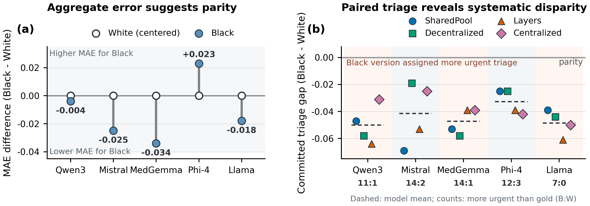

<div align="center">

# Disparity Laundering: Consensus Without Fairness in Clinical Multi-Agent Systems

**Xiaoyang Wang<sup>1</sup> &nbsp;·&nbsp; Tianrui Wang<sup>2</sup> &nbsp;·&nbsp; Christopher C. Yang<sup>1</sup>**

<sup>1</sup>Drexel University &nbsp;&nbsp; <sup>2</sup>University of Michigan, Ann Arbor

[](requirements.txt) [](LICENSE)
<!-- Venue and arXiv badges, to be added when assigned:
[](https://2027.eacl.org/)
[](https://arxiv.org/abs/XXXX.XXXXX)
-->

</div>

<p align="center">
  
</p>

**Figure 1** | The audit's view and the paired view of the same teams. (a) Against MIMIC-IV-ED gold labels, triage error is the same for both groups: the Black − White MAE difference stays within ±0.034 ESI levels in every model. (b) Placing the two versions of each patient side by side exposes the disparity: all 20 model-by-topology teams commit the Black version to more acute triage.

Clinical LLMs are now fielded as multi-agent teams, on the assumption that deliberation averages out individual error. It does not average out bias. We change nothing but the race label on 120 real emergency-department cases from MIMIC-IV-ED and run five open-weight model families through four aggregation topologies. In all 20 configurations the team commits Black patients to more acute triage, and every check that reads one version of the patient at a time (accuracy, consensus, the agents' own rationales) finds nothing wrong. We call this **disparity laundering**. The **Diverse-Perspective Ensemble (DPE)** gives each agent a different demographic version of the same patient, so the team itself performs the comparison no single agent can. It cuts the disparity by up to 94% with no retraining and no architectural change.

This repository contains the cohort-construction, experiment and analysis code behind the paper. It ships no patient-derived text: the cases are rebuilt from MIMIC-IV-ED on your own machine, and every model runs locally.

## Results

**No aggregation design removes the disparity.** Five model families (Qwen3-32B, Mistral Small 3.1, MedGemma 27B, Phi-4, Llama 3.3 70B) × four topologies (SharedPool, Decentralized, Layers, Centralized), 120 cases × 3 seeds per cell. The committed Black − White triage gap is negative in all 20 cells and positive in none of the 60 replicate runs. Every model has a topology that amplifies its single-agent gap, and which topology that is changes from model to model, so no architecture is safe by design.

**The bias lives in ordinary clinical numbers.** In a rerun where every agent writes a rationale, committed triage differs between the two versions in 62 of 720 paired runs, and none of the 1,983 rationales behind those pairs mentions race. The disparity travels in the triage levels, test orders and admission flags the agents emit. Fixes that act on words or on the final step cannot reach it; changing what each agent sees can:

| Intervention | Acts on | Effect on the Black − White triage gap |
|---|---|---|
| Fairness instruction | aggregator | moves by at most 0.02 ESI in every cell |
| Race-word masking | aggregator input | moves by at most 0.02 ESI in every cell |
| Self-debiasing | every agent | widens in 17 of 20 cells |
| **Diverse-Perspective Ensemble** | **what each agent sees** | **shrinks by 67–94% in all five models (SharedPool)** |

Gaps are mean differences in ESI triage level between the Black and White versions of each case. DPE commits one decision per case, so its gap is read between its Black-seeing and White-seeing agents.

**Repair follows pooling.** Ranked by the consensus they produce in homogeneous teams and by the repair they extract from diverse ones, the four topologies fall in the same order. Pooling is indifferent to what it integrates: given five copies of a shared bias, it commits the bias as consensus; given five counterfactual versions of the patient, it cancels them toward parity.

## Method in brief

- **Counterfactual cohort.** 120 MIMIC-IV-ED encounters, each rendered as a short vignette in five variants (White, Black, Hispanic, Asian, no demographic descriptor) that are byte-identical except for one word.
- **Teams.** Five agents of one model answer independently, debate for two rounds, and a synthesis step commits the decision. The topology sets which peers each agent reads: all four others (SharedPool), two ring neighbours (Decentralized), one predecessor (Layers), or a hub (Centralized). Every agent emits the same six-field JSON: ESI triage, laboratory testing, imaging, admission, analgesia and mental-health referral.
- **Cross-version audit.** Run the whole system once per demographic version of the same patient and compare the committed decisions.
- **Diverse-Perspective Ensemble.** Same agents, prompts and topology; each agent reads a different demographic version of the patient.

## Repository

```
scripts/      cohort construction from MIMIC-IV-ED, and the single-agent, debate,
              re-aggregation and DPE probes
src/fairmas/  support package for the probes: backbone client, topologies, scenario loader
analysis/     one script per block of paper numbers, recomputed from the run outputs
figures/      scripts that redraw the paper figures from the published values
assets/       figures used in this README
```

The figure scripts need no data and no GPU:

```bash
git clone https://github.com/wangxiaoyang0412/disparity-laundering.git
cd disparity-laundering/figures
pip install matplotlib numpy
python make_fig8_money.py      # Figure 1
```

Rerunning the experiments takes MIMIC-IV and MIMIC-IV-ED access through [PhysioNet](https://physionet.org/content/mimic-iv-ed/) and a local vLLM endpoint per model: build the cohort with `scripts/gen_mimic_local.py`, then run the probes from the repository root (`PYTHONPATH=src python scripts/probe_debate.py --help`). The data use agreement forbids redistribution, which is why case generation runs entirely against a local model. The teams built here are audit instruments, not clinical decision tools.

## Citation

```bibtex
@misc{wang2026disparity,
  title  = {Disparity Laundering: Consensus Without Fairness in Clinical Multi-Agent Systems},
  author = {Wang, Xiaoyang and Wang, Tianrui and Yang, Christopher C.},
  year   = {2026}
}
```

## License

The code is released under the MIT License. MIMIC-IV and MIMIC-IV-ED remain under the PhysioNet Credentialed Health Data License.

Questions: xw388@drexel.edu, or open a GitHub issue.
